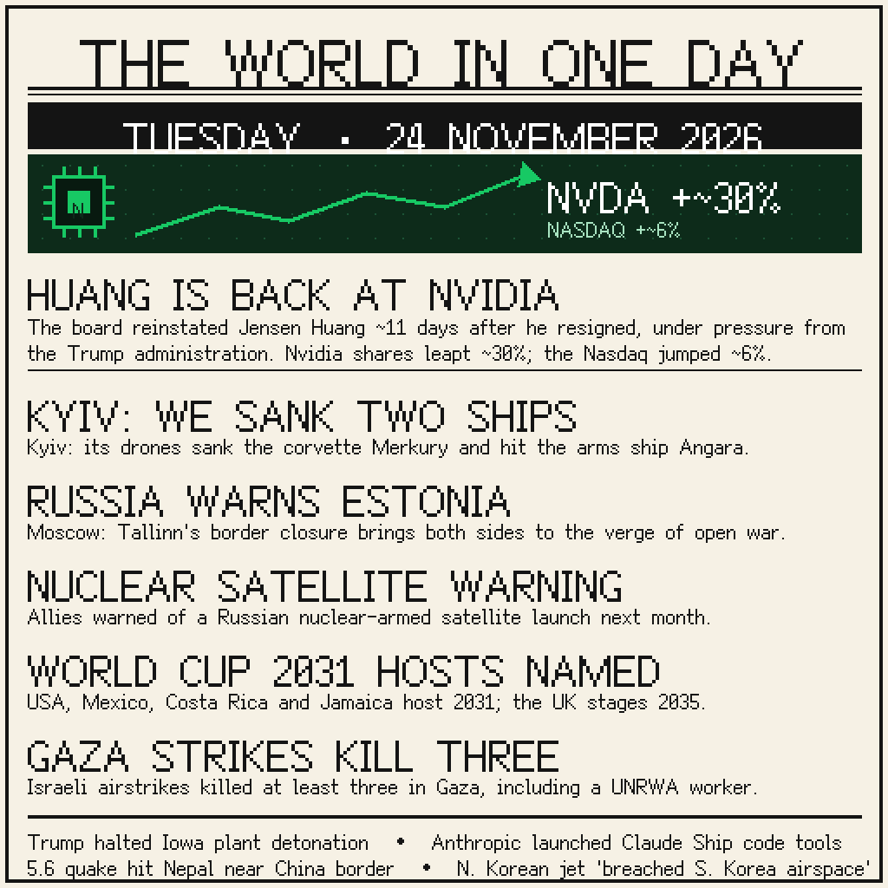

# The World in One Day — Tuesday 24 November 2026

A pixel-art newspaper front page summing up the world news of Tuesday
24 November 2026 in a single image, built for the make.fun bounty
[news-image-20261124](https://make.fun/bounty/news-image-20261124).

## The day's stories

- **Huang is back at Nvidia** — the board reinstated Jensen Huang as chief
  executive ~11 days after he resigned; shares leapt ~30%.
- **Kyiv: we sank two ships** — Ukraine confirmed its naval drones sank
  the corvette Merkury and hit the arms ship Angara off Libya.
- **Russia warns Estonia** — Moscow said Tallinn's border closure brings
  the two sides to the verge of open war.
- **Nuclear satellite warning** — allies warned Russia may launch a
  nuclear-armed satellite next month; NATO vowed to defend space.
- **World Cup 2031 hosts named** — the USA, Mexico, Costa Rica and
  Jamaica will host 2031; the United Kingdom stages 2035.
- **Gaza strikes kill three** — Israeli airstrikes killed at least three
  in Gaza, including a UNRWA worker.

## How it runs

`main.py` (Python 3, standard library only) copies the `entry.png`
sitting beside it into the output directory — `$MAKEFUN_OUTPUT_DIR`,
defaulting to `/output` — as `entry.png`, creating the directory if
needed, and prints the bytes written. It needs no network access and no
third-party package.

## How the image was made

`poster.py` (Python 3 + Pillow, build-time only) draws the front page on
a 512×512 grid — masthead, date band, a pixel-art stock-chart lead
visual, six stories and a ticker strip — then upscales it ×2 with
nearest-neighbour to 1024×1024 and writes `entry.png`.

All text is set in the [Fusion Pixel Font 12px](https://github.com/TakWolf/fusion-pixel-font)
by TakWolf, used under the SIL Open Font License 1.1, at whole multiples
of its 12px design size (12, 24 and 36). The font file is not shipped in
this repository.

## Licence

MIT — see [LICENSE](LICENSE).
